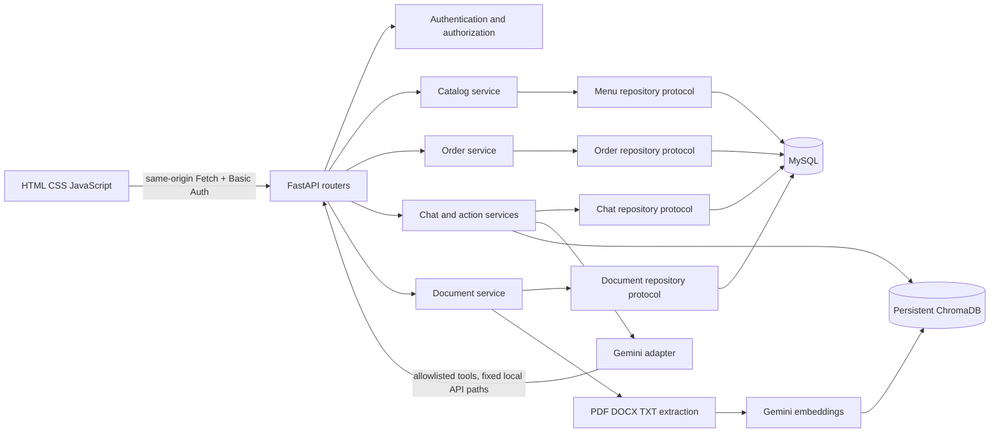
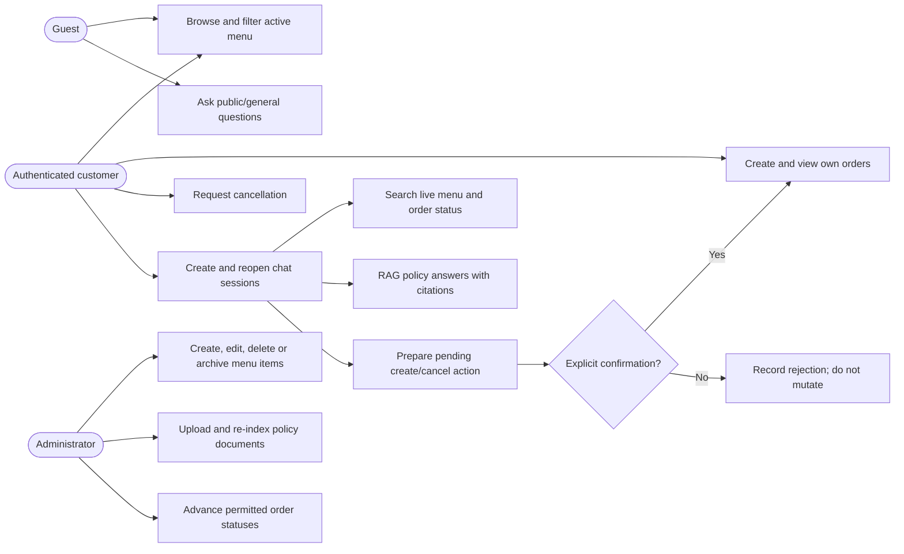

# Architecture and use cases

## Runtime architecture

The browser and Gemini agent use the same validated API and service rules. RAG retrieves active document chunks only; it is not a source of live inventory. Services depend on repository/gateway protocols, while SQLAlchemy, MySQL, Chroma, and Gemini are replaceable adapters. The FastAPI request session is the unit of work for order, stock, and line-item changes.

## Use cases

